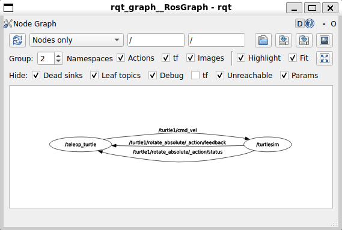
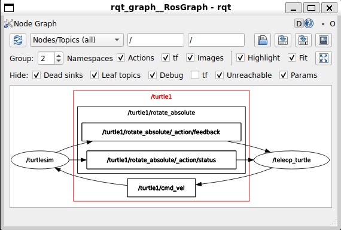

# 06 — ROS2 分層測試與驗收策略

> **工程目標：** 將環境可用性、通訊、程式邏輯、假硬體整合與實機驗收拆成獨立層級，明確定義每項證據能證明的範圍。
>
> **驗證基準：** 2026-11-20 的 ROS2 環境及通訊實驗；2026-11-21 的 AICAR `0.1.0` 核心軟體驗收。任何離線或模擬測試均不啟動實體馬達。

## 6.1 分層驗收策略

```text
環境與套件辨識
      ↓
ROS2 基本通訊與可視化
      ↓
核心程式離線單元測試
      ↓
ROS2 容器與假硬體介面／整合測試
      ↓
實體硬體與場域驗收（待完成）
```

| 測試層級 | 核心問題 | 不代表 |
| --- | --- | --- |
| 環境／Package | 套件是否可建置、安裝、辨識？ | 實體介面及依賴皆能運行 |
| 本機／跨主機通訊 | Node、Topic 與 Middleware 能否交換資料？ | 馬達控制與定位正確 |
| 單元測試 | 邊界條件、數值轉換及狀態更新是否符合設計？ | 真實硬體在所有條件下正常 |
| Smoke／整合測試 | ROS2 API 與模組資料契約能否配合？ | 完整實車端到端延遲、安全性或導航已驗收 |
| 實機 | 真實量測、硬體限制與失聯保護是否符合需求？ | 僅由軟體測試即可推定 |

**設計判斷：** 先取得獨立、可重現的軟體證據，降低實車除錯成本；但不可用較低層級的成功取代較高層級驗收。

## 6.2 ROS2 基本通訊與 GUI 驗證

2026-11-20 在開發端 WSL2 已完成下列測試。Turtlesim 使用獨立測試環境及其示範 Topic，與 AICAR 實體控制隔離；不需直接連接車端。

| 測試 | 實際觀察 | 驗收界線 |
| --- | --- | --- |
| Turtlesim GUI 與鍵盤 Teleop | GUI 開啟、方向鍵操作可使小烏龜移動 | 本機 GUI 與示範控制路徑通過；`/turtle1/pose` 單獨 CLI 輸出尚待查核 |
| Demo Talker／Listener | 本機 `/chatter` 接收成功 | 本機 Publisher／Subscriber 通過 |
| rqt_graph | Node 與 Topic 連線圖可見 | 通訊拓撲證據，無法證明所有 Action 已執行 |
| Zenoh 雙向 String Topic | 有線診斷的雙向測試接收成功 | 跨主機基本通訊 pass；詳見 [04](04-zenoh-firewall.md)，無線待復驗 |
| Chrony | 有線路徑同步及通訊復驗完成 | 詳見 [05](05-time-sync.md)，不代表所有量測時間精度皆已驗收 |

如需在已安裝相應示範套件的隔離環境重新驗證，於不同 Terminal 執行下列純軟體範例；不使用 `aicar1_launch.py`，也不將測試命令發布到真實 AICAR 控制 Topic。

```bash
# Turtlesim GUI and keyboard teleop (separate terminals)
ros2 run turtlesim turtlesim_node
ros2 run turtlesim turtle_teleop_key

# Optional graph inspection
ros2 run rqt_graph rqt_graph
```

## 6.3 rqt_graph：檢視 Node / Topic 連線



*圖 6-1：2026-11-20，Nodes only 檢視。*



*圖 6-2：同一次測試的 Nodes/Topics (all) 檢視。*

| 圖中證據 | 工程判讀 |
| --- | --- |
| `/teleop_turtle` → `/turtle1/cmd_vel` → `/turtlesim` | 已實測的鍵盤速度控制路徑；Publisher 與 Subscriber 責任清楚 |
| `/turtle1/rotate_absolute` 及其 Feedback／Status 相關通道 | 僅證明 Action 關聯端點存在，未證明已發送 Goal 或完成 Action 操作 |

rqt_graph 適合核對 ROS2 資料流與模組介面，不是車體物理模擬器。此示範的關鍵概念也適用於 AICAR 的 Teleop → Base → 回饋 Topic 架構，但兩者的控制功能仍須分別測試。

## 6.4 AICAR 核心軟體驗收（0.1.0）

在完成核心重構後，以假硬體與合成量測進行離線單元測試；不開啟 Serial Port、I²C 或真實機器人網路。正式模組、共用常數及測試涵蓋如下：

| 模組 | 項數 | 驗收焦點 |
| --- | ---: | --- |
| `dxl_arm.py` | 9 | 角度轉換、界限、通訊錯誤與回饋 |
| `dxl_wheel.py` | 13 | 有號／無號轉換、速度模式、停止請求與回饋 |
| `aicar_base.py` | 14 | 差速換算、命令期限、Reset、異常處理及 Encoder 基準 |
| `aicar_imu.py` | 10 | 16-bit 解碼、物理單位、I²C 錯誤與資源清理 |
| `aicar_odom.py` | 19 | 累計輪角、時間戳、量測過期、積分、Reset、Quaternion／TF |
| `aicar_teleop.py` | 11 | 操作限制、回饋基準、命令期限及終端機清理 |
| `constants.py` | 3 | 共用機器人參數及 URDF 名稱契約 |
| **合計** | **79** | **全部通過** |

在 Repository 根目錄執行離線測試：

```bash
PYTHONPATH=src/ai_car python3 -m unittest discover -s src/ai_car/test -p 'test_*.py' -v
```

CI 亦在 Jazzy Docker 容器中完成 `colcon build`、Package 辨識及四個 Node 的實際 ROS2 API／訊息 smoke test（硬體皆為 mock 或合成資料）。[核心驗收 CI 紀錄](https://github.com/zihling-project-ai/ros2-differential-drive-robot/actions/runs/44911788035) 對應 PR #6 提交 `846a695`（其後已合併）；PR #7 僅恢復英文教師 TODO 註解，未修改可執行邏輯。測試不等於實際 DYNAMIXEL SDK／SMBus 安裝與設備連接已驗收。

另外完成一次本機合成資料整合檢查：Teleop → Base → Fake drivers → JointState → Odometry／TF，並確認 Reset 前後累計輪角的連續性，以及 Odometry 與 TF 的位姿／時間戳相符。此為直接串接 Callback 的額外離線檢查，不是實際 ROS2 多主機傳輸測試，也尚非 CI 中獨立的端到端測試項目。

詳細模組責任、設計取捨與未解問題見 [09](09-aicar-ros2-code-review.md)；環境重建及 CI 容器界線見 [02](02-ros2-workspace.md)、[10](10-aicar-docker-deployment.md)。

## 6.5 目前未完成的驗收

| 項目 | 狀態與下一階段 |
| --- | --- |
| 實體馬達、IMU、設備權限與獨立停止保護 | 待現場安全驗收；軟體命令逾時不能取代硬體保護 |
| 無線場域與完整 ROS2 實車通訊 | 待復驗網路路徑、時鐘、Topic、延遲及失聯行為 |
| Gazebo、RViz2 | 已有啟動／模型等部分實驗結果；控制、RobotModel 與 Bridge 尚未全數通過，集中記錄於 [07](07-gazebo-rviz2-aicar-experiment.md) |
| Nav2、SLAM | 已有程式及配置，曾啟動；實機與資料品質尚未完成驗證 |
| LiDAR、Ball Detector | 暫緩重構及功能驗收 |

**實車驗收原則：** 確認實際驅動與設備權限、授權網路、獨立安全保護及有效資料，再由有經驗人員於安全條件下逐項驗證。不得以 GUI 開啟、CI 綠燈或軟體停止命令，取代硬體停止、量測校正與實地運行證據。

**接續：** [07 — Gazebo 與 RViz2 實驗](07-gazebo-rviz2-aicar-experiment.md)。
