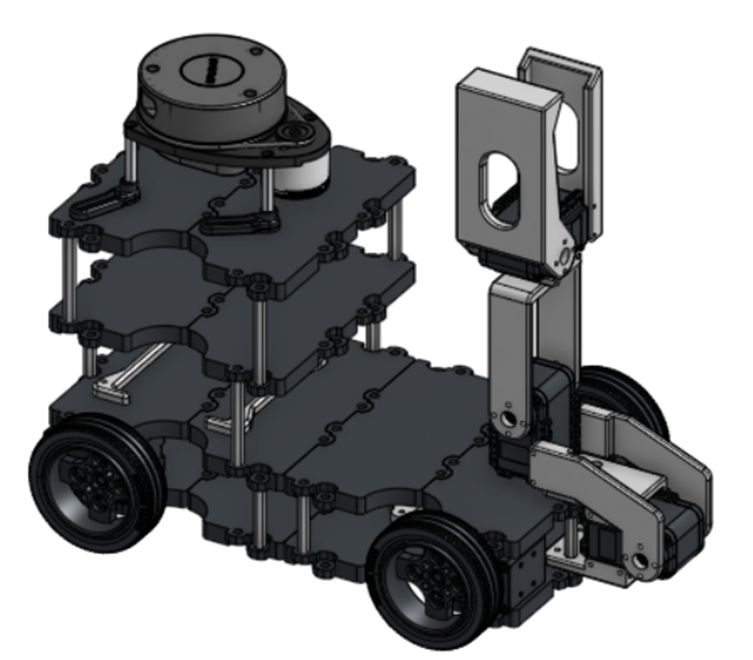
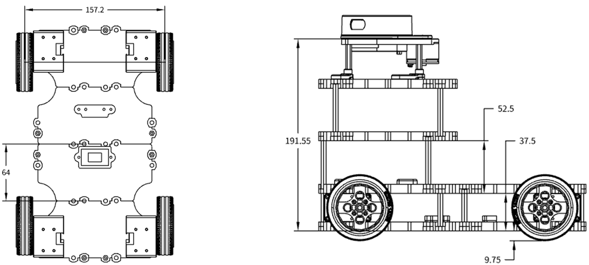
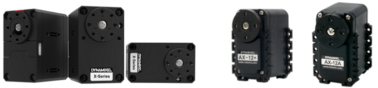

# 08 — AICAR 車體資料、硬體清單與 URDF 物理模型

> **版本**：2026-11-21；**狀態**：工程規格盤點 v0.1。
> **閱讀原則**：「現場／程式已觀察」、「URDF 宣告值」、「官方歷史資料」與「待量測」不得混為一談。本文件已核對 Repository 內 `src/ai_car/urdf/ai_car.urdf` 的 XML 結構與宣告質量；整車質心及實體規格仍待量測。

## 1. 車輛概況

AICAR 是以 **Raspberry Pi 4B** 為車端運算、**4 個驅動輪 + 3 個手臂／末端工具關節**的 ROS2 教學／實驗平台。實車透過 DYNAMIXEL 智慧伺服馬達控制；ROS2 Jazzy 運行 Ubuntu 24.04。2026-11-20 在開發端 WSL2 驗證 Gazebo 模型載入與關節回饋；位置控制及 RViz2 模型顯示尚未通過。

```text
                     Windows 11 / WSL2（開發、模擬、可視化）
                  ROS2 Jazzy / Gazebo / RViz2 / Zenoh Router
                                | Wi-Fi（目標）／Ethernet（診斷備援）
                       Raspberry Pi 4B (robot-host)
                  ROS2 Base / IMU / Odometry / Sensors
                                | U2D2 / DYNAMIXEL
             ┌──────────────────┴─────────────────┐
         四輪驅動馬達 ID 1–4                手臂／工具 ID 11–13
```

## 車體 CAD 與硬體參考圖（本次補充）

> 以下三張圖由使用者提供。圖面可以輔助理解機構布局與標註尺寸，但**不能單憑外觀證實目前實車的馬達型號、零件質量、整車質心或 URDF 數值**。所有機構尺寸應以圖面單位及正式 CAD / BOM 版本再次核對。

### 圖 A：AICAR 整車 CAD 外觀



圖示可辨識四輪底盤、分層式支架、上層圓柱型感測裝置，以及車體前方的多關節機械手臂／末端夾具。**圖中感測器的具體型號仍待核實。**

### 圖 B：AICAR 尺寸工程圖



| 圖面標註 | 標示數值 | 解讀限制 |
|---|---:|---|
| 俯視圖橫向尺寸 | 157.2 | 圖面未在截圖中顯示單位；常見工程圖以 mm 表示，仍須原圖確認 |
| 俯視圖局部尺寸 | 64 | 需由原 CAD 尺寸界線確認量測端點 |
| 側視圖整體高度標註 | 191.55 | 與 URDF 碰撞盒高度不同，不能互相取代 |
| 側視圖其他標註 | 52.5、37.5、9.75 | 局部機構／離地尺寸，需以原始工程圖標註基準核對 |

注意：照片是二維圖紙截圖。上述數字**不等於已驗證實車尺寸**，也不可直接將 157.2 視為 URDF 的 0.16 m 輪距；兩者的基準可能不同。

### 圖 C：DYNAMIXEL 外觀型號參考



圖中左側為標示 **DYNAMIXEL X-Series** 的系列外觀，右側為 **AX-12+／AX-12A** 外觀示意。這是用來比對實車馬達銘牌的參考圖，**不是本車已安裝上述特定型號的證據**；本車型號仍需檢查實體標籤、對應硬體清單與馬達通訊參數。

## 2. 硬體 BOM（已知與未知分開）

| 子系統 | 已知內容 | 證據性質／待確認 |
|---|---|---|
| 運算板 | Raspberry Pi **4B**、Ubuntu 24.04.4 ARM64 | 車端曾實際查核；RAM 容量待確認 |
| 驅動輪 | 四顆 DYNAMIXEL，ID 1=左前、2=右前、3=左後、4=右後 | 程式與實車通訊紀錄；**馬達確切型號待核對銘牌／SDK** |
| 手臂／工具 | 三顆 DYNAMIXEL，ID 11、12、13 | 通訊與程式紀錄；確切型號、減速比待核對 |
| 馬達介面 | ROBOTIS U2D2，Linux 裝置 `/dev/U2D2`、1,000,000 baud；現有測試使用 Protocol 1.0 | 現場程式測試紀錄；實機使用前仍須檢查裝置映射 |
| IMU | 程式預期 MPU9250（WHO_AM_I 暫存器 `0x75`，預期回傳 `0x71`） | `aicar_imu.py` 設定；實體晶片型號與量測校正仍待現場確認 |
| LiDAR | 配置了 `base_scan` 及 `/scan` 資料路徑 | **目前 LiDAR 產品／型號尚未查證**；不要從相似車輛推斷 |
| 攝影機 | 專案／課程配置曾提及 Camera | **是否安裝、品牌與型號待現場確認** |
| 車架／電池 | 客製車體、輪胎、手臂；電源額定規格未知 | 應拍照盤點電池容量、輸出電壓、配電保護 |

### 官方來源與版本界線

- 教師公開 GitHub：[zhl017/ai_car](https://github.com/zhl017/ai_car)（專案標示 *THMR edu ros car*）。截至查閱時預設展示為 **`ros1_noetic`** 分支，其 README 是 ROS1 `catkin_make` / `roslaunch` 操作手冊；**不可直接套用到目前 ROS2 Jazzy 版本**。
- 該公開 README 提到 `rplidar_ros`、`RTIMU`、RViz 與 SLAM，但**不足以證明這台 ROS2 版實車的 LiDAR 型號、電池規格或馬達型號**。請以本車實體銘牌／ROS2 來源程式優先。
- 本次沒有取得老師另一個硬體產品網站的明確網址，因此沒有將其宣稱為已核實來源。

## 3. URDF 結構（Repository XML 盤點）

來源路徑：`src/ai_car/urdf/ai_car.urdf`，STL Mesh：`src/ai_car/meshes/`。

- **11 Links、10 Joints**（包含一個虛擬的 `base_footprint` 及固定關節）。
- `base_footprint` → fixed `base_joint` → `base_link`。
- `base_link` → continuous 四個輪子：`wheel_left_joint`、`wheel_right_joint`、`wheel_rear_left_joint`、`wheel_rear_right_joint`。
- `base_link` → fixed `scan_joint` → `base_scan`；fixed `imu_joint` → `imu_link`。
- 手臂運動鏈：`arm_joint_1` → `arm_link_1` → `arm_joint_2` → `arm_link_2` → `tool_joint` → `arm_tool`。
- Gazebo SDF 內看到 `arm_joint_1` 的 parent 變成 `base_footprint`：可能是固定關節合併（Fixed Joint Lump）造成；**不能解讀為老師改了原始 URDF**。

## 4. URDF 宣告的質量、慣量與幾何

**警告：以下是模型檔宣告值，不是實際秤重或 CAD 重新驗算結果。** `base_footprint` 與 `imu_link` 沒有宣告質量。

| 部件 | URDF 宣告質量 | 備註 |
|---|---:|---|
| 車體 `base_link` | 0.82573504 kg | `base_link` 慣量 `Ixx=0.0022124416`、`Iyy=0.0021193702`、`Izz=0.0020064271` kg·m² |
| 四個輪子 | 每輪 0.02849894 kg | 合計 0.11399576 kg；圓柱 Collision 半徑 0.033 m、長 0.018 m |
| LiDAR link（`base_scan`） | 0.114 kg | 為 URDF 中對應 Link 的質量宣告，**不是型號規格** |
| `arm_link_1`、`arm_link_2`、`arm_tool` | 各 0.079119962 kg | 三個連桿數值相同，需確認是否真實 CAD 輸出或範例配置 |
| **模型質量總和** | **1.291090686 kg** | 僅上述 Link 加總；**不等於已驗證整車實際重量** |

車體 Collision 盒：`0.27 × 0.14 × 0.19 m`，中心相對 `base_link` 的 Z 約 `+0.09 m`。此為**碰撞盒尺寸**，不是整車包含手臂的外形長寬高。

輪子輪心相對 `base_link` 位置：前後 X≈±0.092 m、左右 Y≈±0.080 m、Z≈0.023 m；輪胎半徑 0.033 m。`base_link` 相對 `base_footprint` Z≈0.010 m，因此初始輪心高度接近地面上的 0.033 m。

程式所用名義輪距約 **0.16 m**，輪半徑 **0.033 m**；四輪在左右兩側以差速速度命令驅動，轉彎可能發生輪胎側向滑移，不能直接將理想二輪差速模型當作完整四輪接觸動力學。

`tool_joint` 在原 URDF：旋轉軸 `(0,0,1)`、角度範圍 `[0,1.57] rad`、速度宣告 50 rad/s、effort 宣告 1000、未定義 dynamics。這些是模型參數，**不代表伺服馬達真實額定性能**。

目前 `constants.py` 中工具命令範圍為 0～45°，而 URDF 為約 0～90°。兩者責任不同：前者是程式命令範圍，後者是模型宣告；未實機驗證前不修改既有校正與限制。

## 5. 質心（Center of Mass / CoM）與慣量如何驗證

**目前尚無可信的整車 CoM 座標。不得從 `base_link` 或 Collision Box 中心直接推定全車質心。**

每個 Link 的 `<inertial><origin xyz=...>` 是該 Link 的慣性座標系；若要算整車質心，須先將它轉換到同一個 Frame（例如 `base_footprint`）：

```text
整車質心 (x, y, z) = Σ(各 Link 質量 × 各 Link 質心座標) / Σ各 Link 質量
```

由於手臂可移動，**整車 CoM 會隨 arm_joint_1、arm_joint_2、tool_joint 的角度改變**；所以必須指定姿態（例如三個關節均為 0 rad）。

**驗證清單**：

1. 逐 Link 抽取 `mass`、`origin.xyz/rpy`、慣量矩陣；對照 URDF Joint Origin 建立 FK 轉換。
2. 在指定手臂姿態下，以質量加權計算 CoM，必要時使用 CAD / inertia calculator 獨立交叉驗算。
3. 秤重整車（含電池）、量測輪胎半徑、軸距、胎距，記錄測量誤差及版本。
4. 驗證模型慣量矩陣是否對稱且正定，並確認單位 kg·m²。
5. 比較實車重量與模型重量；差距不能在沒有分析前直接用縮放係數補上。

### 可在 AICAR 工作區重跑的 URDF 盤點腳本

以下唯讀程式輸出所有 Link mass、inertial origin、inertia 與 Joint type/limit，**不會自行聲稱算出整車 CoM**：

```bash
python3 - <<'PY'
from pathlib import Path
import xml.etree.ElementTree as E
p=Path.home()/'ros2_ws/src/ai_car/urdf/ai_car.urdf'
r=E.parse(p).getroot()
for link in r.findall('link'):
    i=link.find('inertial')
    mass=i.find('mass') if i is not None else None
    origin=i.find('origin') if i is not None else None
    inertia=i.find('inertia') if i is not None else None
    print('LINK',link.get('name'), 'mass=',mass.attrib if mass is not None else None,
          'origin=',origin.attrib if origin is not None else None,
          'inertia=',inertia.attrib if inertia is not None else None)
for j in r.findall('joint'):
    print('JOINT',j.get('name'), j.get('type'),
          'parent=',j.find('parent').attrib if j.find('parent') is not None else None,
          'child=',j.find('child').attrib if j.find('child') is not None else None,
          'origin=',j.find('origin').attrib if j.find('origin') is not None else None,
          'limit=',j.find('limit').attrib if j.find('limit') is not None else None)
PY
```

## 6. ROS2 控制／觀測資料流（已知程式職責）

```text
/cmd_vel ──> aicar_base ──> 輪速計算 ──> DYNAMIXEL ID 1–4
/wheel_torque ──> aicar_base（獨立車輪啟用要求）
/joint, /tool, /torque ─> aicar_base ──> 臂部馬達 ID 11–13
                               ├─> /joint_states（七個 Joint）
                               └─> /diff_rad（保留教學差量）
IMU ──> aicar_imu ──> /imu ─┐
/joint_states（累計角度與時間戳） ─> aicar_odom ─┴─> /odom + TF（odom→base_footprint）
URDF + /joint_states ──> robot_state_publisher ──> TF ──> RViz2
```

軟體節點有其理想輪距、半徑與資料型別；它們不是經場地實測校準的物理參數。模擬 `/sim/joint_states` 與實體 `/joint_states` 應分開並保持控制安全。

## 7. 當前 Gazebo 實驗觀測（引用 [07](07-gazebo-rviz2-aicar-experiment.md)）

- 無位置控制器時，量測 `arm_joint_1≈0 rad`、`arm_joint_2≈0 rad`、`tool_joint=1.57 rad`。
- 加入 `tool_joint` Position Controller 後，觀察到速度在約 `±50 rad/s` 間交替及車體側向位移；**控制不穩定，漂移原因尚未確立**。
- RViz2 GUI 已啟動，但最後畫面只有 Grid，尚未完成 RobotModel/TF 驗收。
- Gazebo 模型沒有經物理校準，不能稱為已驗證 Digital Twin。

## 8. 待查／下一步

| 優先度 | 未知事項 | 如何查證 |
|---|---|---|
| P0 | 實車馬達型號／額定扭矩／控制模式 | 讀取馬達型號 Register、核對銘牌與官方型錄 |
| P0 | LiDAR、Camera、電池、配電板實物型號 | 現場拍照、`lsusb`、`i2cdetect`、驅動設定檔 |
| P1 | 各 Link CoM、完整 inertia 與指定姿態的整車 CoM | 已取得 URDF；依版本盤點與交叉驗算 |
| P1 | 實測車重與重心、輪距與輪半徑 | 電子秤、幾何量測、姿態及接觸試驗 |
| P1 | 實車速度／角速度與編碼器誤差 | 安全環境實測並記錄負載／電池狀態 |
| P1 | Gazebo 物理接觸與 PID 振盪根因 | 對照實驗、固定模擬時間步長、輸出與碰撞診斷 |

## 9. 來源與可信度

- **當事系統輸出**：2026-11-20 開發端 WSL2／Pi 的 `ros2`、`gz topic`、URDF 解析輸出及實驗畫面。
- **教師公開上游**：[zhl017/ai_car GitHub](https://github.com/zhl017/ai_car)；其首頁目前是 ROS1 Noetic 操作手冊，而非本次 Jazzy 模型的逐行權威來源。
- **本次已取得**：Repository ROS2 URDF；未知品牌型號、實測總重量及指定姿態質心座標仍維持「待確認」。
